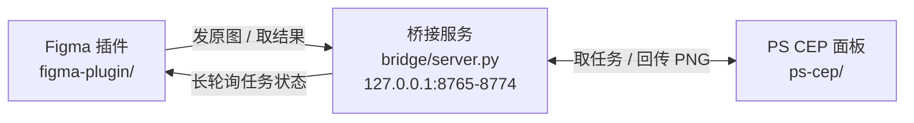

# Figma ⇄ Photoshop 位图桥接

把 Figma 里选中的图片丢进 Photoshop 修图，改完一键回传，**自动覆盖回 Figma 里的同一个图层**。
不导出、不重新上传、不改画布裁切位置；PSD 存过之后再打开也还能认回原图层继续改。

  -3776AB) 

---

## 这个项目解决什么

Figma 里的位图（照片、纹理、渲染图、AI 出图）要精修时，常规做法是：导出 PNG → 在 PS 里改 → 再拖回 Figma → 重新裁切对位。图片一多就变成流水线上的重复劳动，而且很容易贴歪。

这个项目的做法是**只搬字节，不搬图层**：

- Figma 插件取到该填充的**原始图片字节**（不是截图，是 imageHash 指向的原文件），发给本机桥接服务；
- PS 面板拿到原图后直接在 PS 里打开，你随便改（调色、修瑕、合成、甚至裁图）；
- 点「保存并回传 Figma」，PNG 回传给桥接服务，Figma 插件把同一个图层里的图片填充换掉。

因为画布上的节点没变，图层位置、尺寸、层级、命名、裁切全部保持原样。

---

## 架构



三端都是本机跑，服务只监听 `127.0.0.1`，不经过任何外部服务器。

| 组件 | 技术 | 职责 |
| --- | --- | --- |
| `bridge/` | Python 3（零依赖） | 任务队列、图片暂存、长轮询、状态机、落盘持久化 |
| `figma-plugin/` | Figma Plugin API | 取原图字节、记录目标图层、回写 imageHash |
| `ps-cep/` | CEP + Node + ExtendScript | 在 PS 里打开原图、导出 PNG、写/读任务标记 |

---

## 安装

**环境要求**

- Windows 10/11
- Photoshop 2022 或更高（CEP 9+）
- Figma **桌面版**（网页版不支持开发插件）
- Python 3（安装时勾选 “Add Python to PATH”）

**步骤**

1. 解压后双击 `部署器.bat`，选 `[1] 一键部署`。它会做四件事：
   - 把 `ps-cep/` 复制到 `%APPDATA%\Adobe\CEP\extensions\figma-ps-bridge`
   - 写入注册表 `HKCU\Software\Adobe\CSXS.9~14\PlayerDebugMode = 1`（解除 CEP 签名校验）
   - 在桌面创建「启动 PS 桥接」快捷方式
   - 把 Figma 插件清单路径复制到剪贴板
2. Figma → 菜单 `插件 → 开发 → 从清单导入插件...`，选择 `figma-plugin/manifest.json`（只需要导一次）
3. 双击桌面「启动 PS 桥接」，保持那个黑窗口开着
4. 重启 Photoshop → `窗口 → 扩展(旧版) → Figma 桥接`

整个文件夹可以放在任意位置（U 盘也行），换机器重新跑一次 `部署器.bat` 即可。

---

## 使用

**第一次发送**

1. Figma 里选中一张图片（或一个带图片填充的画框）→ 打开插件 `插件 → 开发 → PS 桥接`
2. 点「发送选中到 PS」
3. PS 面板会弹出提示，图片自动在 Photoshop 里打开（画布尺寸 = 原图像素尺寸）
4. 改完点「保存并回传 Figma」
5. Figma 里原图层自动更新，视图会滚到该图层

**反复修改（核心用法）**

回传之后任务**不会结束**：

- 在 PS 里继续改，再点一次「保存并回传 Figma」，Figma 会覆盖同一图层 —— 不会一层层堆新图层
- Figma 插件会一直守着这个任务，检测到更新的结果就自动贴回

**PSD 断点续接**

PS 里直接「存储为」PSD（文件名随意），关掉 PS，第二天再打开这个 PSD：

- PS 面板会自动认出这是哪个任务，状态显示「已回写 · 可再传」
- 改完点「保存并回传 Figma」即可继续覆盖
- Figma 那边重开插件也会自动接上上次的任务

原因是任务 id 被写进了 PSD 的 XMP 元数据（`doc.info.jobName = figma-bridge:<jobId>`），随文件一起保存，跟文件名、存盘位置无关。

**其它按钮**

| 位置 | 按钮 | 作用 |
| --- | --- | --- |
| Figma 面板 | 发送选中到 PS | 把选中节点的原图发给 PS |
| Figma 面板 | 认出原图层 | 不需要手动选中，按保存的信息自动选中并滚动到原图层 |
| Figma 面板 | 继续等待 | 监听暂停后恢复（长轮询超时不会丢任务） |
| Figma 面板 | 停止等待 | 结束当前监听；还没回传过的任务会被标记为失败，已回写过的只停监听、记录留着 |
| PS 面板 | 保存并回传 Figma | 导出 PNG 回传（会校验当前文档的任务标记，防止多开时传错任务） |
| PS 面板 | 立即接收一张 | 手动拉一次待处理任务（关闭自动接收时用） |
| PS 面板 | 取消当前任务 | 放弃当前任务 |

---

## 工作方式

### 取哪张图

- 目标节点（或其 3 层以内子级）有图片填充 → 取 `figma.getImageByHash(hash).getBytesAsync()`，即**原始图片全分辨率字节**，同时记下 `imageWidth/imageHeight`、`paintIndex`
- 没有图片填充 → 用 `node.exportAsync()` 渲染成 PNG（2–4 倍，目标最长边约 4096），标记 `fallback: true`

### 怎么贴回去

- 尺寸没变（PS 里只调色/修图）→ 只替换 `imageHash`，**保留原填充的 `scaleMode` 和 `imageTransform`**，画布上的裁切与对位完全不变
- 尺寸变了（PS 里裁过图）→ 新旧图坐标系对不上，改用 `scaleMode: FILL` + 单位矩阵，避免错位或留白
- 目标节点根本不能装图片填充 → 在附近新建一个矩形图层放图，并把新图层的 id 回传面板；以后回传就直接覆盖这张，不会越堆越多

### 任务状态

```
awaiting-image → pending → editing → ready → done
                              └────→ failed
```

- `awaiting-image`：Figma 已建任务，图还没传上来
- `pending`：原图就绪，等 PS 来取
- `editing`：PS 已领取（超过 `EDIT_TIMEOUT_SEC`，默认 600 秒没动静会自动释放回 `pending`）
- `ready`：PS 回传了新结果，等 Figma 取
- `done`：Figma 已取走并贴好
- `failed`：PS 端报错或用户取消

**关键设计**：`PUT /result` 不校验当前状态，所以 `done` 的任务也能被重新置回 `ready`；Figma 端用 `updatedAt > appliedAt` 判断「这是新的一份结果」。这两点合起来才实现了「结束之后还能再覆盖」。

任务记录落盘在 `bridge/.data/jobs.json`，服务重启后仍在；已完成/失败的任务保留 **30 天**（给「隔很久再重开 PSD」留余量）。

### 连接细节

- 端口：8765–8774 依次尝试，避开 Clash/mihomo 这类常占 8765 的代理软件；可用环境变量 `PORT` 强指定
- 长轮询：`GET /api/jobs/<id>/status?wait=25`，最多挂 25 秒；PS 面板靠 `/api/ps/pending` 轮询顺带当心跳
- Figma 插件的 `networkAccess.allowedDomains` 里固定写了这 10 个 localhost 端口（Figma 只允许声明 localhost）
- 图片上限 256 MB

---

## HTTP 接口

| 方法 | 路径 | 说明 |
| --- | --- | --- |
| `GET` | `/` | 浏览器可看的状态页 |
| `GET` | `/api/health` | `{ ok, version, jobs, port, psOnline }` |
| `GET` | `/api/jobs` | 全部任务 |
| `POST` | `/api/jobs` | 新建任务（body 为 meta JSON），返回 `id` 与 `uploadUrl` |
| `GET` | `/api/jobs/<id>` | 单个任务 |
| `GET` | `/api/jobs/<id>/status?wait=25` | 长轮询等状态变化 |
| `PUT` | `/api/jobs/<id>/image` | Figma 上传原图（body 为 PNG 字节） |
| `GET` | `/api/jobs/<id>/image` | PS 下载原图 |
| `PUT` | `/api/jobs/<id>/result` | PS 回传结果图 |
| `GET` | `/api/jobs/<id>/result` | Figma 取结果 |
| `POST` | `/api/jobs/<id>/ack` | Figma 确认已贴好 → `done` |
| `POST` | `/api/jobs/<id>/fail` | 标记失败，body 可带 `{"error": "..."}` |
| `POST` | `/api/jobs/<id>/claim` | 手动领取任务 |
| `GET` | `/api/ps/pending` | PS 拉待处理任务（同时刷新心跳） |

---

## 目录结构

```
figma-ps-bridge/
├─ 部署器.bat              # 部署器入口（菜单式）
├─ deploy.ps1              # 部署逻辑：装扩展、写注册表、建快捷方式
├─ bridge/
│  ├─ server.py            # 桥接服务（Python 标准库，零依赖）
│  ├─ 启动桥接.bat          # 双击启动服务
│  └─ .data/               # 运行时：jobs.json + 图片缓存（git 忽略）
├─ figma-plugin/
│  ├─ manifest.json        # Figma 插件清单（含 localhost 白名单）
│  ├─ code.js              # 主线程：取图、回写、定位图层
│  └─ ui.html              # 面板 UI：发送、监听、认出原图层
└─ ps-cep/
   ├─ CSXS/manifest.xml    # CEP 扩展清单（开启 Node）
   ├─ index.html           # PS 面板 UI
   ├─ js/main.js           # 面板逻辑：轮询、导出、回传、认领标记
   └─ host/index.jsx       # ExtendScript：打开文件、写/读标记、导出 PNG
```

---

## 常见问题

**PS 里看不到扩展**
重启 Photoshop；入口在 `窗口 → 扩展(旧版)`（不是「扩展」）。若仍没有，确认注册表 `HKCU\Software\Adobe\CSXS.11\PlayerDebugMode`（按版本号）为 `1`，再跑一次 `部署器.bat` 的 `[2] 检查安装状态`。

**面板显示「桥接服务未连接」**
双击桌面「启动 PS 桥接」，看黑窗口是否有报错。服务只监听本机，杀毒/防火墙一般不会拦；若报端口全被占用，设环境变量 `PORT` 换个端口（同时要改 Figma 清单白名单）。

**PS 面板显示「Node 未启用」**
CEP 的 `CEFCommandLine` 必须包含 `--enable-nodejs --mixed-context`，检查 `CSXS/manifest.xml` 是否被改动过。

**重开 PSD 没认出任务**
- 确认是「存储为/保存」的 PSD，且文件里有 XMP（另存为某些精简格式会丢元数据）
- 任务超过 30 天会被清理，任务表里查不到时面板会提示「已过期」
- 面板「取消当前任务」过的标记会被记住，不会自动认回来

**改完回传，Figma 那边没动静**
确保 Figma 面板还开着（监听在面板里跑）；关掉重开也会自动接上上次任务。日志里会写明卡在哪一步。

**多开 PSD 会串任务吗**
不会。回传前会读当前文档的 `jobName` 标记，以文档为准；标记为空则直接报错拒传。

---

## 已知限制

- 只同步**位图**：图层结构、文字、矢量、蒙版都不动，PS 里新建的图层也不会回流到 Figma（只取合并后的 PNG）
- 传到 PS 的是原图本身（可能是 4096×2304），不是画布上一次的显示效果；Figma 里的裁切/旋转在 PS 里看不到
- PS 面板一次只处理一个任务
- 无鉴权，仅靠只监听 `127.0.0.1` 保证安全；不要在公网暴露该端口
- 仅 Windows（部署脚本用 PowerShell + 注册表）

---

## 开发

```bash
# 启动桥接服务（带日志）
python bridge/server.py

# 语法检查
python -m py_compile bridge/server.py
```

改完代码：
- `bridge/`：重启桥接服务即可
- `ps-cep/`：重新跑 `部署器.bat` 的 `[1]`，然后在 PS 里关掉面板重新打开（或重启 PS）
- `figma-plugin/`：Figma 里 `插件 → 开发 → 重新运行插件`
