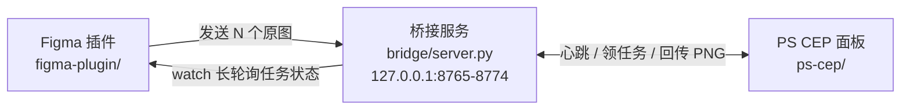

# Figma ⇄ Photoshop 位图桥接

> **v0.3.3 · 多图并行 + PS 现场感知**
> 一次选 N 个图层发给 PS，PS 里 **N 个文档同时开着**，任意顺序编辑；存成 PSD、关掉 PS，隔天重开依然能认回各自的 Figma 原图层并覆盖回去。

把 Figma 里选中的图片丢进 Photoshop 修图，改完一键回传，**自动覆盖回 Figma 里的同一个图层**。
不导出、不重新上传、不改画布裁切位置；PSD 存过之后再打开也还能认回原图层继续改。

   -3776AB) 

**0.3.3 修复**：在 PS 里把发过去的图关掉（没回传），任务不会再赖在 Figma 列表里 —— 只要 PS 打开过又关掉，列表立刻收起；同时 PS 面板会把该任务标记结束，不让它在桥接里一直挂着。另外「刚发出、PS 还没接手」的显示缓冲限制为 **60 秒**（原来是无期限）。

**0.3.2 修复**：在 PS 里打开一个 PSD，Figma 会立刻（≤3 秒）显示它的任务 —— 原来上报时看的是「会话表」，被「取消」过的任务即使文档开着也不会显示。现在以 **PS 里真实打开的文档**为准，文档开关时立即上报。老任务会自动补缩略图。

**0.3.1 修复**：桥接服务加了**单实例保护** —— 重复双击「启动桥接」不会再起第二个服务（以前会导致 Figma 连 A、PS 连 B，明明任务在却报「任务不存在」）；任务列表**跟随 PS**：默认只显示 PS 里打开的任务。

**0.3.0 新增**：Figma 能实时看到 PS 那边在干什么（`PS 正在看：<图层名>` + 每行 `PS 已打开` 徽标）；任务行带缩略图；顶部信息与运行日志都可折叠。

**0.3.0 新增**：Figma 能实时看到 PS 那边在干什么（`PS 正在看：<图层名>` + 每行 `PS 已打开` 徽标）；任务行带缩略图；顶部信息与运行日志都可折叠，把空间留给任务列表。

**0.2.2 修复**：PS 里点过「取消任务」之后，重开 PSD 再回传也能自动覆盖 —— `failed` 不再是「Figma 永久拒收」，只是「上次没好结果」的标记；只要桥接上出现比已贴版本更新的结果就会自动恢复监听并贴回。**唯一需要手动点「继续等待」的，只剩你在 Figma 里主动点过「停止」的任务。**

**0.2.1 修复**：`done` 任务不再退出监听 —— PSD 存盘关掉、隔天重开再回传时，Figma 会自动接上新结果并贴回原图层。PS 面板回传后还会在后台确认 Figma 是否真的贴回，没贴回会明确提示。

**0.2.0 主要变化**：多选批量发送、任意多个文档并行编辑（不再有全局 `busy`）、600 秒租约自动释放、批量 `watch` 长轮询、条件 `ack`（旧结果不会误删新图）、PS 多文档会话列表与「全部回传」、部署器 Python 检测修复。
完整清单见 [docs/CHANGELOG.md](docs/CHANGELOG.md)，三端契约见 [docs/multi-doc-spec.md](docs/multi-doc-spec.md)。

> 升级提示：桥接服务、Figma 插件、PS 面板请一起升级。旧版面板不会使用 `/api/ps/jobs`、心跳和租约续约，拿不到多文档并行能力；新面板连旧桥会走兼容回退并在状态栏提示升级。**0.2.1 的 Figma 插件只改插件本身，`插件 → 开发 → 重新运行插件` 即生效；PS 面板改动需重跑部署器 `[1]` 并重启 PS。**

---

## 这个项目解决什么

Figma 里的位图（照片、纹理、渲染图、AI 出图）要精修时，常规做法是：导出 PNG → 在 PS 里改 → 再拖回 Figma → 重新裁切对位。图片一多就变成流水线上的重复劳动，而且很容易贴歪。

这个项目的做法是**只搬字节，不搬图层**：

- Figma 插件取到该填充的**原始图片字节**（不是截图，是 imageHash 指向的原文件），发给本机桥接服务；
- PS 面板拿到原图后直接在 PS 里打开，你随便改（调色、修瑕、合成、甚至裁图）；
- 点「保存并回传」，PNG 回传给桥接服务，Figma 插件把同一个图层里的图片填充换掉。

因为画布上的节点没变，图层位置、尺寸、层级、命名、裁切全部保持原样。

多张图时同理：**一个 Figma 图层 = 一个任务 = 一份 PS 文档**，各任务互相独立。N 个文档可以同时开着，你想先改哪张就改哪张，不用等前一张回传完。

---

## 架构



三端都是本机跑，服务只监听 `127.0.0.1`，不经过任何外部服务器。

PS 端是 **CEP 扩展**（入口在 `窗口 → 扩展(旧版)`），不是 UXP 面板；桥接服务同时服务 Figma 插件与这个 CEP 面板。

| 组件 | 技术 | 职责 |
| --- | --- | --- |
| `bridge/` | Python 3（零依赖） | 多任务队列、租约、图片暂存、批量长轮询、条件 ack、GC、落盘持久化 |
| `figma-plugin/` | Figma Plugin API | 多选取原图、任务注册表、批量监听、串行回写、认出原图层 |
| `ps-cep/` | CEP + Node + ExtendScript | 多文档会话、打开原图、按 docId 保存回传、租约续约 |

---

## 安装

**环境要求**

- Windows 10/11
- Photoshop 2022 或更高（CEP 9+）
- Figma **桌面版**（网页版不支持开发插件）
- Python 3（安装时勾选 “Add Python to PATH”；如果 `python` 不在 PATH，部署器和启动脚本会自动回退到 `py -3` / `py`）

**步骤**

1. 解压后双击 `部署器.bat`，选 `[1] 一键部署`。它会做四件事：
   - 把 `ps-cep/` 复制到 `%APPDATA%\Adobe\CEP\extensions\figma-ps-bridge`
   - 写入注册表 `HKCU\Software\Adobe\CSXS.9~14\PlayerDebugMode = 1`（解除 CEP 签名校验）
   - 在桌面创建「启动 PS 桥接」快捷方式
   - 把 Figma 插件清单路径复制到剪贴板
2. Figma → 菜单 `插件 → 开发 → 从清单导入插件...`，选择 `figma-plugin/manifest.json`（只需要导一次）
3. 双击桌面「启动 PS 桥接」，保持那个黑窗口开着（脚本会打印实际用的 Python 启动命令）
4. 重启 Photoshop → `窗口 → 扩展(旧版) → Figma 桥接`

整个文件夹可以放在任意位置（U 盘也行），换机器重新跑一次 `部署器.bat` 即可。

**部署器菜单**

| 选项 | 作用 |
| --- | --- |
| `[1]` | 一键部署（PS 扩展 + 注册表 + 快捷方式 + 打印 Figma 导入步骤） |
| `[2]` | 检查安装状态（扩展、注册表、Python、桥接服务、Photoshop 进程） |
| `[3]` | 启动桥接服务 |
| `[4]` | 查看 Figma 插件导入步骤，并定位/复制清单文件 |
| `[5]` | 打开扩展安装目录 |
| `[0]` | 退出 |

自动化/重装场景可以跳过菜单，直接一键部署：

```powershell
.\部署器.bat -Auto          # 等价于 powershell -File deploy.ps1 -Auto
```

`-Auto` 会执行与 `[1]` 相同的全量部署，结束后直接退出（不进入菜单循环），适合脚本或远程重装。

---

## 使用

### 多选发送（一次 N 张）

1. 在 Figma 里**选中 N 个图片 / 带图片填充的画框**（支持跨层级多选）
2. 按钮会变成「发送 N 个到 PS」，点一下即可；点击后按钮立即置为「发送中…」，双击不会重复建任务
3. PS 面板自动接收，**每 2 秒最多打开 1 个文档**（避免 PS 连续弹窗卡死），N 个文档会依次打开
4. 已经在监听中的同一个图层会被自动跳过，不会重复建任务

每个节点独立成败：某一张取图失败只会在日志里记一条，不影响其它节点。

### 多文档会话列表

PS 面板会列出所有从 Figma 收到的文档：

- 状态徽标：`正在打开` / `待编辑` / `已回传` / `文档已关闭` / `已取消` / `出错`
- 当前活动文档高亮显示，保存按钮会写成「保存并回传「文档名」」
- 每个会话都可以单独「回传」或「取消」，也可以用顶部的「全部回传」
- 文档可以按任意顺序编辑，互不影响；在 PS 里关掉某个文档只会把该会话标成「文档已关闭」，其它文档继续
- 文档列表由 PS 的 `doc.id` + XMP 里的任务标记（marker）共同识别，面板重开、PSD 重开都会重新登记

### 保存并回传（只认当前活动文档）

- 按钮只对**当前活动文档**生效：先读活动文档的 marker，再按 `docId` 精确定位导出，最后 `PUT /result`
- 当前文档没有任务标记 → 直接报错「不是从 Figma 发来的」，不会误传
- 按 `docId` 找不到目标文档 → 返回 `ERR:NOT_FOUND`，**不会回退到 `activeDocument`**，绝不会写错文档
- 回传成功后该会话显示「已回传」；Figma 贴回并 ack 后任务变成「已回写 · 仍在监听」（继续守着这个图层，随时可以再传）

### 全部回传（N 个）

- 一次回传会话列表里所有「待编辑」且有 `docId` 的文档
- 逐个执行，**单个失败不中断**，最后汇总「成功 N / 失败 M」
- 导出的是副本（`asCopy`），不会改动你 PSD 里的内容，也不会关闭文档；单个文档失败不影响其余文档

### 租约与 600 秒自动释放

多文档并行靠「租约」防止任务互相卡死，用户只需要知道一句话：**面板开着就会自动续租；面板关了/PS 崩了，10 分钟后任务自动回到「待领取」，不会被永久占住。**

细节（便于排查）：

- PS 面板给每个「待编辑」的文档每 **20 秒**续租一次（`POST /api/jobs/<id>/touch`；已回传的会话不再续租）
- 某个任务超过 **600 秒**没有任何续租，桥接服务自动把它从 `editing` 放回 `pending`；**只影响这一个任务**，其它文档照常
- 600 秒可用环境变量 `EDIT_TIMEOUT_SEC`（秒）覆盖，仅用于调试/演示
- 面板或 PSD 重开后，会按文档列表重新登记并自动 `claim` 夺回租约，**不会重新打开文档**

### PSD 断点续接（隔天重开）

1. PS 里「存储为」PSD（文件名随意，保留 XMP 元数据）
2. 关掉 PS；第二天重新打开这个 PSD（以及 PS 面板）
3. 面板按 XMP 里的 `figma-bridge:<jobId>` 标记认出文档，会话列表里显示「待编辑」或「已回传」
4. 改完点「保存并回传」→ 桥接里该任务变成 `ready`
5. **Figma 面板会自动接上并把结果贴回原图层，不需要任何额外操作**

> 从 0.2.1 起，Figma 端回写成功后会停在「已回写 · 仍在监听」状态继续盯着这个任务（不再自动停止监听），
> 所以 PSD 隔天重开、再回传多少次都会自动贴回同一个图层。旧版本需要手动点「继续等待」，这个动作现在只在
> 你主动「停止」过某个任务、或任务失败后才需要。

改完并回传后，Figma 里原图层自动更新，视图会滚到该图层。如果只是想找回原图层、不打算回传，点「认出原图层」即可（任务过期也能用，`targetId` 会保留）。

### 反复修改

- 每次「保存并回传」都会覆盖**同一个图层**，不会一层层堆新图层
- 回写成功后任务停在「已回写 · 仍在监听」，继续守着这个图层 —— 想反复覆盖，直接在 PS 里再改再传即可，**不用回 Figma 点任何按钮**
- 「继续等待」现在只用于恢复你**主动停止**过、或**已过期**的任务；失败的任务在 PS 重新回传时会自动恢复，不用点
- 「清空已完成」只移除这些记录，不影响 PS 里已打开的文档

### PS 现场状态（Figma 知道 PS 在做什么）

只要 PS 里的「Figma 桥接」面板开着，Figma 面板就会显示 PS 那边的现场情况：

- 顶部一行：`PS 正在看：<图层名>`（蓝色 ◆）、`PS 里开着 N 张`、`PS 空闲`、`PS 面板未连接`
- 任务行徽标：`◆ PS 正在看`（当前活动文档对应的任务）、`PS 已打开`（文档开着但不是当前活动）
- 刷新节奏自适应：面板有焦点 3 秒一次，切到后台 15 秒；有任务在监听时由长轮询驱动，PS 一换文档几乎立刻可见（实测约 0.8 秒）

> 这是**只读感知**，Figma 不会反过来控制 PS。可靠的前提是 PS 面板开着 —— 它就是上报方。
> PS 里打开一个没有任务标记的文档，Figma 只能显示「开着 N 张」，无法对应到具体图层。

### 面板空间（折叠 + 缩略图）

- 右上 `⚙` 收起/展开「说明 + 桥接地址」，**默认收起**
- 「运行日志」点标题即可收起/展开，**默认收起**；收起后若出现错误，标题上会亮小红点
- 每个任务行左侧显示**缩略图**：发送时由插件生成 68px 预览并存入本地注册表，重启插件后仍在
- **老任务会自动补图**：没有缩略图的记录会请主线程按原图层重新渲染一张（一次最多补 3 个）；原图层已被删除的显示占位方块 ▢，不会反复重试
- 两种折叠状态都会记住，下次打开面板保持

### 任务列表跟随 PS

- 默认**只显示 PS 里打开的任务**：PS 关掉某个 PSD，Figma 列表里对应那条自动收起（记录仍在，不会被删）
- 判断依据是 **PS 里真实打开着的文档**（读 XMP 标记），不是「会话表」—— 所以即使某个任务被「取消」过，只要 PSD 还开着，Figma 里就会显示
- 打开/关闭/切换文档后 **≤3 秒**就会同步（PS 面板每 3 秒扫一次文档列表，一旦有变化立刻上报，不等下一轮心跳）
- 刚发出、PS 还没接手时最多保留显示 **60 秒**；PS 一旦打开过它，之后关掉就立刻收起
- **PS 里关掉还没回传的图**：任务会从列表收起，同时 PS 面板通知桥接把任务标记结束（不会在后台一直占着），并把该任务加入「不再自动接收」
- 点右上角的 `只看 PS 中 / 显示全部` 可以切换；想看历史任务、用「认出原图层」时切到「显示全部」
- 标题显示 `2 / 5` 表示「显示 2 个 / 共 5 条记录」
- PS 面板没连上（或面板是旧版本）时会自动退回「显示全部」，不会把列表清空

> 只想保留一个桥接服务：重复双击「启动桥接」会被拒绝启动并提示已有实例在运行（v0.3.1 起）。
> 这一点很重要 —— 曾经出现过 Figma 连 A、PS 连 B 的情况，表现为「任务明明在，PS 却说任务不存在」。

### 按钮一览

| 位置 | 按钮 | 作用 |
| --- | --- | --- |
| Figma 面板 | 发送 N 个到 PS | 把当前选中的全部节点发给 PS（已在监听中的自动跳过） |
| Figma 面板 | 认出原图层（每行） | 切换页面、选中并缩放到该任务记录的原图层；过期任务仍可用 |
| Figma 面板 | 停止（每行） | **唯一的硬停止**：任务立刻退出监听，之后 PS 再怎么回传都不会自动贴回。已回写过的只停监听、记录保留（「认出原图层」仍可用）；还没回写过的会额外通知服务端放弃任务、释放 PS 侧占用。想恢复就点「继续等待」 |
| Figma 面板 | 继续等待 | 把「已停止监听 / 过期」的任务重新加入监听（「已回写」的任务一直在监听；`failed` 在 PS 重新回传时会自动恢复，也不用点） |
| Figma 面板 | 清空已完成 | 从列表移除已停止/失败/过期记录，不影响 PS 里打开的文档 |
| PS 面板 | 保存并回传「文档名」 | 只回传当前活动文档（必须带 marker） |
| PS 面板 | 全部回传（N 个） | 逐个回传所有「待编辑」文档，汇总成功/失败 |
| PS 面板 | 回传（每行） | 只回传这一份文档，按该会话的 `docId` 精确定位 |
| PS 面板 | 立即接收一张 | 关闭「自动接收」时手动领取一个待处理任务 |
| PS 面板 | 取消（每行） | 停掉这个任务在 PS 里的会话：未回传的会通知桥接失败；**不关闭**已打开的文档；重启面板不再自动接回。之后若又想覆盖，直接对那份 PSD 点「保存并回传」即可自动恢复（Figma 侧会重新接上） |
| PS 面板 | 自动接收 | 每 2 秒检查新任务并开图（设置会持久化） |

---

## 工作方式

### 取哪张图

- 目标节点（或其 3 层以内子级）有图片填充 → 取 `figma.getImageByHash(hash).getBytesAsync()`，即**原始图片全分辨率字节**，同时记下 `imageWidth/imageHeight`、`paintIndex`
- 没有图片填充 → 用 `node.exportAsync()` 渲染成 PNG，标记 `fallback: true`
  - 导出倍率：`min(4, max(1, 4096 / 最长边))`，向下取整到 2 位小数；**1–4 倍，长边尽量不超过 4096，最小 1 倍**
  - 例：3000px 画框 → 4080px（1.36 倍），5000px 画框 → 5000px（1 倍）；实际倍率记录在 `meta.exportScale`
  - 旧版公式下限是 2 倍，会把 3000px 画框导成 6000px、5000px 导成 10000px，0.2.0 已修正

### 怎么贴回去

- 尺寸没变（PS 里只调色/修图）→ 只替换 `imageHash`，**保留原填充的 `scaleMode` 和 `imageTransform`**，画布上的裁切与对位完全不变
- 尺寸变了（PS 里裁过图）→ 新旧图坐标系对不上，改用 `scaleMode: FILL` + 单位矩阵，避免错位或留白
- 目标节点没有可用的 IMAGE 填充但能装填充 → 往 `fills` 末尾追加一个图片填充
- 目标节点根本不能装图片填充 → 新建一个矩形图层放图：
  1. 先切换到目标所在页面
  2. 用 `target.absoluteBoundingBox`（页面绝对坐标）换算到目标父容器的坐标，而不是直接用父级相对的 `target.x/y`
  3. 追加到能容纳子级的父容器（页面 / Frame / Group / Section）；其它容器（如 Component Set、Instance）一律落到当前页面，失败只做有限次重试
  4. 把新图层的 `targetId` 回传面板并写进注册表，以后回传就直接覆盖这张，不会越堆越多

### 任务状态

```
awaiting-image → pending → editing → ready → done
                              └────→ failed
editing 超过 EDIT_TIMEOUT_SEC（默认 600 秒）无 touch → pending（释放租约）
```

- `awaiting-image`：Figma 已建任务，图还没传上来
- `pending`：原图就绪，等 PS 来取
- `editing`：PS 已领取（面板每 20 秒续租；600 秒没动静自动释放回 `pending`）
- `ready`：PS 回传了新结果，等 Figma 取
- `done`：Figma 已取走并贴好
- `failed`：PS 端报错或用户取消

**关键设计**：

- 0.2.0 删掉了全局 `busy`：任意多个任务可以**同时**处于 `editing`，PS 里就是 N 个文档同时开着
- `PUT /result` 不校验当前状态，所以 `done` 的任务也能被重新置回 `ready`，这是「PSD 隔天重开再覆盖」的基础
- `ack` 是条件化的：Figma 回写成功后带 `{"updatedAt": <刚贴的那份结果的 updatedAt>}` 再确认；如果服务端发现值已经变了（PS 又传了新图），返回 `{ok:false, stale:true}` 且**不删文件、不改状态**——旧结果不会误删新结果
- Figma 端用 `updatedAt > appliedAt` 判断「这是新的一份结果」；只有 `apply-done` 成功后才 ack 并前移 `appliedAt`，写回失败则不 ack 并按 2s→4s→8s→15s→30s 退避重试；**连续失败 3 次**会停止重试并把任务标成 `failed`（避免不可修复的错误无限重试），处理后点「继续等待」可清零重试

任务记录落盘在 `bridge/.data/jobs.json`，服务重启后仍在；处于 `editing` 的任务重启后会放回 `pending`。已完成/失败的任务保留 **30 天**（给「隔很久再重开 PSD」留余量），GC 每 10 分钟清理一次过期记录、对应目录和没有记录的孤儿目录。

### 多文档并行细节

- **PS 面板**：每 2 秒一次循环 → `POST /api/ps/heartbeat` → `GET /api/ps/jobs` → 对 `pending` 且不在会话表/取消列表里的任务，每轮最多打开 1 个
- **文档扫描**：每 3 秒调用宿主 `figmaBridgeListDocs()`，按 `docId` + marker 登记/刷新会话；文档从 PS 里消失 → 会话置 `closed`
- **续租**：每个 `open`（待编辑）会话超过 20 秒没续租 → `POST /touch`；如果返回的状态不是 `editing`（租约被超时释放或被别的客户端领走），再 `POST /claim` 夺回，不重新打开文档
- **Figma 协调器**：只要注册表里还有 `watching` 的任务，就把所有 id 合并成一次 `GET /api/jobs/watch?ids=...&wait=25`；`ready` 的结果取回后**串行**写回画布，写完 `apply-done` 再决定 ack；失败按任务独立退避
- 没有在等的任务时，协调器降级为每 2 秒 `GET /api/health`，只刷新连接指示灯

### 连接细节

- 端口：8765–8774 依次尝试，避开 Clash/mihomo 这类常占 8765 的代理软件；可用环境变量 `PORT` 强指定
- 心跳：PS 面板每 2 秒 `POST /api/ps/heartbeat`；`/api/health` 只读，**不刷新心跳**；`psOnline` 以 8 秒为窗口
- 长轮询：`GET /api/jobs/watch?ids=a,b,c&wait=25`，单次最多挂 25 秒；超时后立即重新发起，**没有轮次上限**（旧版 240 轮、约 100 分钟后会停掉监听，0.2.0 已取消）
- 单任务长轮询 `GET /api/jobs/<id>/status?wait=25` 保留，供旧客户端/调试用
- Figma 插件的 `networkAccess.allowedDomains` 里固定写了这 10 个 localhost 端口（Figma 只允许声明 localhost）
- 图片上限 256 MB；`jobs.json` 解析失败会备份成 `jobs.bad.<时间戳>.json` 并从空表启动

---

## HTTP 接口

> 接口契约以 [docs/multi-doc-spec.md](docs/multi-doc-spec.md) 第 3 章为准。`publicJob` 结构：`{id, status, createdAt, updatedAt, meta, hasSource, hasResult, error}`（内部 `lastTouch` 不暴露）。

| 方法 | 路径 | 说明 |
| --- | --- | --- |
| `GET` | `/` | 浏览器可看的状态页（v0.3.0，所有值转义） |
| `GET` | `/api/health` | `{ok, version, jobs, port, psOnline, ps}`；**只读，不刷新心跳** |
| `POST` | `/api/ps/heartbeat` | 刷新 PS 心跳；body 可带 `{"activeJobId": "...", "openJobIds": ["..."]}`（PS 现场状态），返回 `{ok, psOnline:true, jobs, ps}` |
| `GET` | `/api/ps/pending` | **语义变更**：领取**下一个** `pending` 任务（一次一个，置 `editing`），返回 `{job, sourceUrl}`；没有则 `{"job":null}`。**不再返回 `busy`**，不会因为别的任务在 editing 而阻塞。仅作旧面板兼容（领取时顺带刷新心跳） |
| `GET` | `/api/ps/jobs` | 返回 `{jobs:[publicJob...], ps}`（全部任务，客户端自己按 status 过滤） |
| `GET` | `/api/jobs` | 全部任务 |
| `POST` | `/api/jobs` | 新建任务（body 为 meta JSON），返回 `id` 与 `uploadUrl` |
| `GET` | `/api/jobs/<id>` | 单个任务 |
| `GET` | `/api/jobs/<id>/status?wait=25` | 单任务长轮询（保留） |
| `GET` | `/api/jobs/watch?ids=a,b,c&wait=25` | 批量长轮询：任一 id 的 `updatedAt` 变化、**或 PS 现场状态变化**就返回 `{jobs:[publicJob...], ps}`；不存在的 id 省略；`ids` 为空立即返回空数组；`wait` 上限 25 秒 |
| `PUT` | `/api/jobs/<id>/image` | Figma 上传原图（body 为 PNG 字节），状态 → `pending` |
| `GET` | `/api/jobs/<id>/image` | PS 下载原图 |
| `PUT` | `/api/jobs/<id>/result` | PS 回传结果图，状态 → `ready`（不校验旧状态，`done` 也可再覆盖） |
| `GET` | `/api/jobs/<id>/result` | Figma 取结果 |
| `POST` | `/api/jobs/<id>/ack` | **条件化**。body 可带 `{"updatedAt": <ms>}`：带了且与当前 `updatedAt` 不等 → `{ok:false, stale:true, job}`，**不删文件、不改状态**；相等或没有 body → 清理 source/result 并置 `done`，返回 `publicJob + {ok:true}` |
| `POST` | `/api/jobs/<id>/fail` | 标记失败，body 可带 `{"error": "..."}` |
| `POST` | `/api/jobs/<id>/claim` | 手动领取任务（置 `editing` 并刷新租约；PS 重开文档后夺回用） |
| `POST` | `/api/jobs/<id>/touch` | **新增**。续租：只刷新 `lastTouch`，**不动 `updatedAt`**（避免空唤醒 Figma 的 watch），返回 public job |

---

## 目录结构

```
figma-ps-bridge/
├─ 部署器.bat              # 部署器入口（菜单式；支持 -Auto）
├─ deploy.ps1              # 部署逻辑：装扩展、写注册表、建快捷方式、检测 Python
├─ README.md
├─ docs/
│  ├─ multi-doc-spec.md    # 多文档并行契约（三端实现的唯一依据）
│  └─ CHANGELOG.md         # 版本说明
├─ tools/
│  └─ e2e_multi.py         # 多文档并行 e2e 模拟客户端（纯标准库）
├─ bridge/
│  ├─ server.py            # 桥接服务 0.2.0（Python 标准库，零依赖）
│  ├─ 启动桥接.bat          # 双击启动服务（python → py -3 → py 自动回退）
│  └─ .data/               # 运行时：jobs.json + .data/<jobId>/{source,result}.png（git 忽略）
├─ figma-plugin/
│  ├─ manifest.json        # Figma 插件清单（含 localhost 白名单）
│  ├─ code.js              # 主线程：多选取图、注册表、串行回写、定位图层
│  └─ ui.html              # 面板 UI：多选发送、多任务列表、批量 watch、认出原图层
└─ ps-cep/
   ├─ CSXS/manifest.xml    # CEP 扩展清单（开启 Node）
   ├─ index.html           # PS 面板 UI：多文档会话列表、保存/全部回传
   ├─ js/main.js           # 面板逻辑：心跳、领任务、按 docId 回传、续租、全部回传
   └─ host/index.jsx       # ExtendScript：开图/写读 marker/列文档/按 docId 导出
```

---

## 常见问题

**PS 里看不到扩展**
重启 Photoshop；入口在 `窗口 → 扩展(旧版)`（不是「扩展」）。若仍没有，确认注册表 `HKCU\Software\Adobe\CSXS.11\PlayerDebugMode`（按版本号）为 `1`，再跑一次 `部署器.bat` 的 `[2] 检查安装状态`。

**面板显示「桥接服务未连接」**
双击桌面「启动 PS 桥接」，看黑窗口是否有报错。服务只监听本机，杀毒/防火墙一般不会拦；若报端口全被占用，设环境变量 `PORT` 换个端口（同时要改 Figma 清单白名单）。

**PS 面板显示「Node 未启用」**
CEP 的 `CEFCommandLine` 必须包含 `--enable-nodejs --mixed-context`，检查 `CSXS/manifest.xml` 是否被改动过。

**重开 PSD 没认出任务**
- 确认是「存储为/保存」的 PSD，且文件里有 XMP（另存为某些精简格式会丢元数据）
- 任务超过 30 天会被清理，任务表里查不到时面板会提示「已过期」
- 面板「取消」过的标记会被记住（`ignored` 持久化），不会自动认回来

**PSD 隔天重开、回传后 Figma 没动静**
Figma 端任务在第一次回写成功后是「已完成」并停止监听。请先在 PS 回传，再在 Figma 面板点「继续等待」；点完 25 秒内完成回传也行。Figma 面板重开时，注册表里仍是 `watching` 的任务会自动接上，不需要手点。

**多开 PSD 会串任务吗**
不会。保存时只认**当前活动文档**，先校验它必须有 Figma 写入的 XMP marker；然后按 `docId` 精确定位导出并回传，找不到 `docId` 就报 `ERR:NOT_FOUND` 并拒传，**绝不回退 `activeDocument`**。所以不会出现把 A 文档的图传给 B 任务（点击保存的瞬间请不要切换文档）。唯一的外部操作风险：如果你手动复制一个带 marker 的 PSD，两个文档会带同一个任务标记，回传时会按当前活动文档处理（建议复制后确认要覆盖哪一份）。

**某个任务一直「待编辑」，重新打开面板也没用**
只要面板还开着，待编辑文档每 20 秒续租，任务不会掉；如果面板关了/PS 崩了，600 秒后桥接会自动把任务释放回 `pending`。重开面板后：PSD 还开着 → 按 marker 重新登记并自动争回租约；没有打开的文档 → 会作为新任务重新打开。若想立刻释放，重启桥接服务（处于 `editing` 的任务重启后会回到 `pending`）。

**发送了 N 个，PS 只打开了一部分**
面板每 2 秒最多打开 1 个文档，避免 PS 连续弹窗；N 个会依次打开。PS 正在弹对话框/打开大文件时会暂停，关掉对话框后继续。也可以在面板点「立即接收一张」手动催一次。

**PS 开着对话框时保存报错「无法读取当前文档的任务标记」**
这是预期行为：读不到就是读不到，不会假装「没有标记」。关掉对话框后重试即可（`ERR` 与「确实没有标记」在日志/状态里是分开提示的）。

**换了一个 Figma 文件，旧任务记录还在**
任务注册表存在 `figma.clientStorage` 里，是**插件级共享**的，不按 Figma 文件隔离。换文件后插件只会提示「记录来自另一个文件，原图层可能对不上」，并不会阻止回写。不需要的旧记录：先逐行点「停止」，再点「清空已完成」；也不要在新文件里对旧任务点「继续等待」，否则可能在新文件里生成 fallback 图层。

**改完回传，Figma 那边没动静**
确保 Figma 面板还开着（监听在面板里跑），且任务是 `watching` 状态；`done` 任务需要「继续等待」。日志里会写明卡在哪一步。

**Figma 日志里出现「写回失败」**
任务会自动按 2s→4s→8s→15s→30s 重试；连续 3 次失败会停止重试并把任务标成失败。看日志里的具体原因（原图层被删、节点被锁定/只读、fallback 容器拒绝接收等），处理后点「继续等待」即可清零重试。

---

## 已知限制

- 只同步**位图**：图层结构、文字、矢量、蒙版都不动，PS 里新建的图层也不会回流到 Figma（只取合并后的 PNG）
- 传到 PS 的是原图本身（可能是 4096×2304），不是画布上一次的显示效果；Figma 里的裁切/旋转在 PS 里看不到
- **不做「一个 PSD 多图层」**：一个 Figma 图层 ↔ 一个 PS 文档；多张图就是多个文档，不会合成到同一个 PSD 的多图层里（契约第 1 章明确非目标）
- **多文档并行依赖 XMP marker**：`figma-bridge:<jobId>` 写在 PS 文档的 XMP 里，随 PSD 落盘；若 PSD 丢失 XMP（某些精简/导出格式）或手动清掉元数据，就无法认回任务，只能重新从 Figma 发一次
- 任务记录保留 30 天；过期后不能再覆盖原图层（Figma 面板里仍可「认出原图层」，记录里保留了 `targetId`）
- Figma 回写成功后任务进入「已完成」并停止监听，要继续覆盖需要点「继续等待」（设计如此，避免无意义的长轮询）
- 任务注册表是插件级共享的（所有 Figma 文件共用）：换文件只提示不隔离，旧任务若被回写可能在新文件里生成 fallback 图层；换文件后建议先停止旧任务再清空记录
- 无鉴权，仅靠只监听 `127.0.0.1` 保证安全；不要在公网暴露该端口
- 仅 Windows（部署脚本用 PowerShell + 注册表）

---

## 开发

```bash
# 启动桥接服务（带日志）
python bridge/server.py
# 本机 python 不在 PATH 时：
py -3 bridge/server.py

# 语法检查
python -m py_compile bridge/server.py
node --check figma-plugin/code.js
node --check ps-cep/js/main.js

# 多文档并行 e2e（自动挑端口、复制服务到临时目录后拉起子进程）
python tools/e2e_multi.py
# 常用参数：--port 18765 指定端口、--no-isolate 就地运行、--lease-wait N 调整租约等待
```

`tools/e2e_multi.py` 只依赖标准库，退出码 `0` = 全部通过，非 `0` = 有失败并逐条打印原因。当前 8 条断言：多任务并行领取、`/api/ps/pending` 无 `busy`、touch 续租与超时释放、`watch` 唤醒、条件 ack（正确/过期两种）、心跳上线/离线。

改完代码：

- `bridge/`：重启桥接服务即可（历史任务会从 `.data/jobs.json` 恢复）
- `ps-cep/`：重新跑 `部署器.bat` 的 `[1]`，然后在 PS 里关掉面板重新打开（或重启 PS）
- `figma-plugin/`：Figma 里 `插件 → 开发 → 重新运行插件`

三端协议/接口改动必须先改 [docs/multi-doc-spec.md](docs/multi-doc-spec.md) 再改代码；版本记录写在 [docs/CHANGELOG.md](docs/CHANGELOG.md)。
